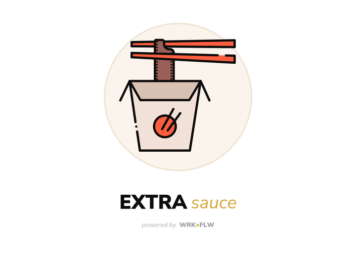

# Extra Sauce

Extra Sauce takes a camera-specific look profile (a `.dcp` file, such as a film emulation pack's per-camera
profiles) and rebuilds it for cameras the original was never made for. Your old Lightroom presets then keep
working on new bodies.

It also turns phone-app presets into LUTs. You apply the preset to a colour chart, drop the result in, and get
a `.cube` file back.

Windows only for now. It needs Lightroom Classic or Adobe Camera Raw installed, because it builds on Adobe's
own camera profiles.

## Download

Get `ExtraSauce.exe` from [wrkxflw.github.io/extra-sauce](https://wrkxflw.github.io/extra-sauce) or the [Releases](../../releases) page and run it. You don't need to install anything.

## Camera profiles

1. Drop look profiles into **Your looks**, or use Add files / Folder. You can drop a whole folder of them. If
   a look was made for several cameras, you only need one copy; extra copies are skipped.
2. Search for the cameras you want under **New cameras** and tick as many as you like.
3. Choose where the profiles go:
   - **Install into Lightroom** writes to
     `%APPDATA%\Adobe\CameraRaw\CameraProfiles\Generated Profiles`. Restart Lightroom afterwards.
   - **Save copies to** also saves them to a folder (`Desktop\Extra Sauce Profiles` by default).
   - **Skip cameras that already have the look** leaves the original maker's own versions alone.
4. Click **Convert**. Every look is made for every ticked camera, and the Activity panel shows an accuracy
   check for each look.

A converted profile keeps the original's name, so a preset that asks for that profile by name picks it up on
the new camera without any edits.

### How it works

A DCP applies these steps in order: camera matrices → HueSatMap (calibration) → LookTable (the look) → tone
curve. Look makers build on Adobe Standard's matrices, so the look can be measured as what it does on top of
Adobe Standard's calibration:

    T = look's LookTable ∘ look's HueSatMap ∘ (Adobe Standard HueSatMap)⁻¹

T is sampled into a 90×25×16 LookTable with sRGB value encoding. The new profile is the target camera's Adobe
Standard profile (its matrices and calibration) with T as its LookTable and the look's own tone curve.

**Accuracy check:** the look is rebuilt for its own camera and compared with the original across 40,000
colours (ΔE76 in Lab). Tested against a film pack's real profiles for other bodies, the method lands within
about 1 ΔE on average.

You need an Adobe Standard profile for both the original camera and each target camera. They ship with
Lightroom Classic and Camera Raw in `C:\ProgramData\Adobe\CameraRaw\CameraProfiles\Adobe Standard`.

## Phone presets (LUTs)

This is for app presets that can't be exported, such as discontinued ones.

1. **Save blank chart** writes a 1548px chart of 15,625 colour patches (25 levels per channel) inside a
   mid-grey border.
2. On the phone, apply the preset at full strength with no other edits, and export it at full size. Bring it
   back as the original file, not through a messaging app.
3. Drop the exports in and click **Make LUTs**. Each export becomes a 33-point `.cube` named after its file.
   Display P3 exports are converted to sRGB first, and resized exports are rescaled.
4. Warnings flag an uneven border (vignette or light leak), a grainy border (grain), or a chart that looks
   unedited. A LUT holds colour only.
5. To turn the `.cube` into a Lightroom profile, use Photoshop: open Camera Raw, go to Presets, Alt-click
   Create Preset, choose Create Profile, then pick Color Lookup Table with Space set to sRGB.

Tested against a phone app's own export on a real photo, the LUT came out at 1.0 ΔE average.

## Building from source

    python -m venv .venv
    .venv\Scripts\pip install -r requirements.txt
    .venv\Scripts\python main.py                      # run it
    .venv\Scripts\pyinstaller --noconfirm build_win.spec   # build dist\ExtraSauce.exe

`tools/make_logo.py` redraws the logo, icon and splash.

## Credits

- The default Adobe tone curve (`app/acr3_curve.txt`) comes from [RawTherapee](https://rawtherapee.com)
  (GPL-3.0).
- The font is [Nunito Sans](https://github.com/Fonthausen/NunitoSans), used under the SIL Open Font License
  (`app/web/fonts/OFL.txt`).
- Extra Sauce is powered by WRK×FLW.

Extra Sauce isn't affiliated with or endorsed by Adobe or any preset or profile maker. Adobe, Lightroom and
Camera Raw are trademarks of Adobe Inc. No third-party profiles are included in this project: you supply your
own.

## License

GPL-3.0. See [LICENSE](LICENSE).
